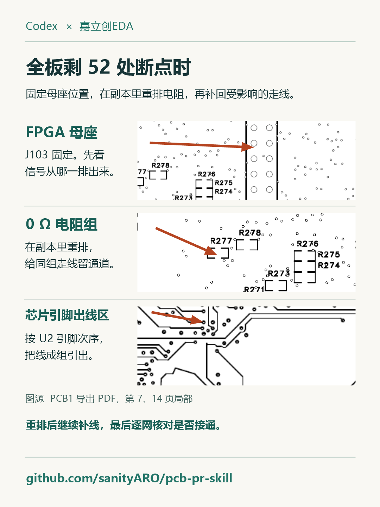
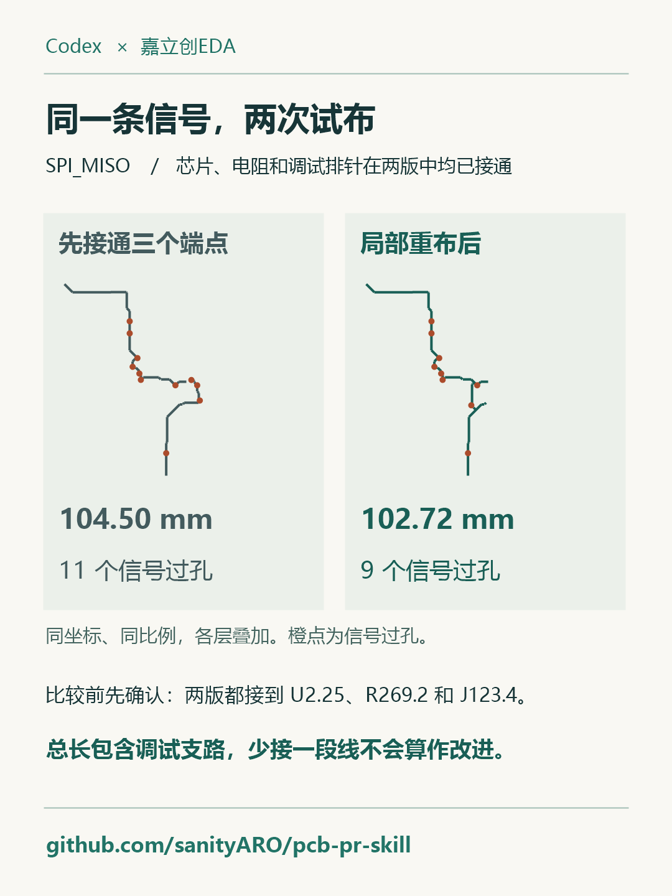
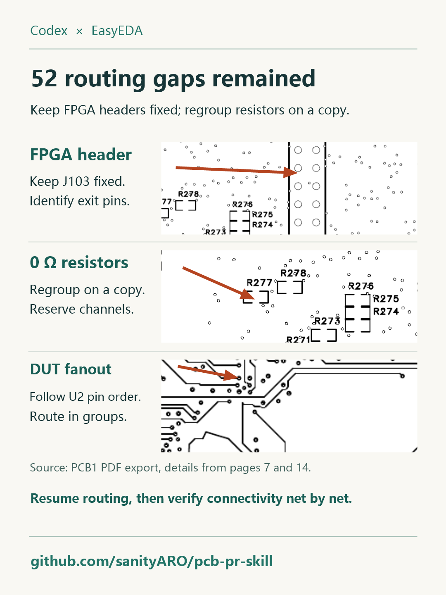
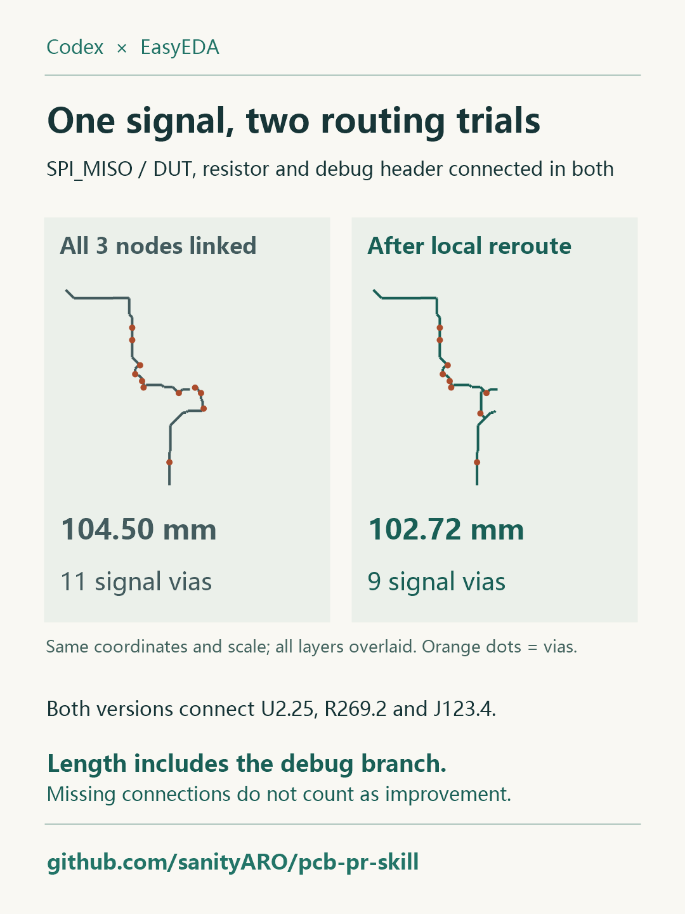
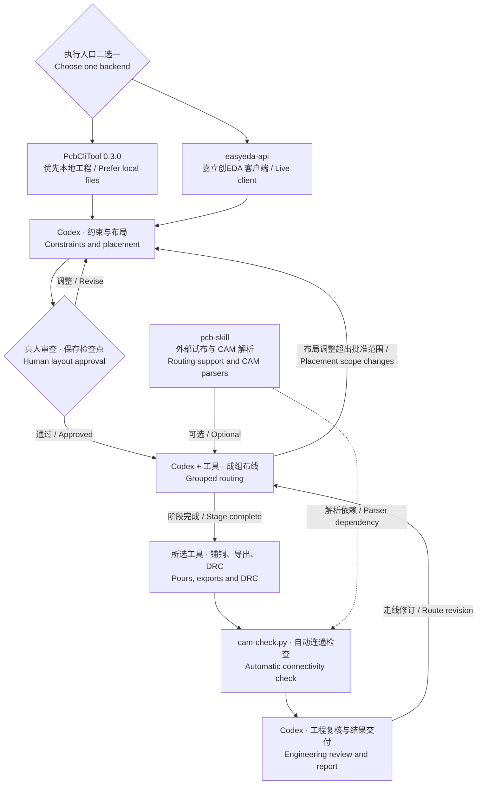

# pcb-pr-skill

**布线卡住时回调布局，接通后减少绕线，交付前核对实铜。**

**Revise congested placement, reduce routing detours, and verify exported copper.**

面向从板级原理图到布局、布线和制造文件核验的 AI 辅助流程。当前验证组合为 **Codex + 嘉立创EDA**；方法可迁移到其它 AI/EDA，执行接口与文件兼容性需适配验证。

An AI-assisted workflow from board schematics to placement, routing and fabrication-data checks, currently exercised with **Codex + 嘉立创EDA (EasyEDA)**. The methods can transfer to other agents and EDA tools with validated adapters and file support.

## 解决什么 · What it helps solve

| 遇到的问题 / Problem | 工作方法 / Method |
|---|---|
| 串联电阻挡住出线 / Resistor banks block escape routes | 回到副本重排器件，按引脚顺序成组扇出。Regroup parts and fan out signals in pin order on a copy. |
| 接通后仍有绕弯、多次换层 / Connected routes take detours | 局部重布，按相同端点比较长度、过孔和回流。Reroute locally and compare length, vias and returns for the same endpoints. |
| 完成提示无法证明制造文件接通 / Completion does not establish CAM connectivity | 对照 Gerber、镀孔和独立焊盘网表检查漏接与短接。Check exported copper and plated drills against an independent pad manifest. |

## 六层芯片测试板案例 · Six-layer test-board example

既有 pcb-skill 与路由器流程在该板遇到拥塞，pcb-pr-skill 整理了从布局回退到继续布线的方法。

Congestion in the existing pcb-skill/router workflow motivated the placement rollback and routing continuation methods collected here.

**中文图示**

<p>
<a href="assets/grouped-fanout.png"></a>
<a href="assets/spi-miso-reroute.png"></a>
</p>

**English figures**

<p>
<a href="assets/grouped-fanout-en.png"></a>
<a href="assets/spi-miso-reroute-en.png"></a>
</p>

| 已记录结果 / Recorded result | 比较范围 / Scope |
|---|---|
| 全板断点 **52 → 4 → 0** / Board routing gaps | 成组重排后继续局部补线，多个步骤共同完成。Multiple placement and routing steps contributed. |
| SPI_MISO **104.50 → 102.72 mm**，信号过孔 **11 → 9** / Signal vias | 两版均接通 U2.25、R269.2、J123.4，长度包含调试支路。Same three endpoints, including the debug branch. |
| **303 nets / 1,134 pads** | 0.025 mm 栅格 CAM 连通核验通过；记录的原生 DRC 为 0 项。CAM connectivity passed at 0.025 mm resolution; native DRC reported zero items. |

图片展示实际布局与同坐标走线比较。已完成该版布线，**待打板验证**；几何改善尚未证明信号质量或功能改善。

The figures show actual placement and route comparisons in common coordinates. Routing is complete for the recorded revision; **fabrication and hardware validation are pending**. Geometric improvements have not established signal-integrity or functional gains.

## 工作流程 · Workflow



布局完成后提交真人审查，确认后再布线，可保存检查点稍后继续。已批准范围内可局部优化；改变已确认布局约束时复审受影响部分。

Submit the completed layout for human approval before routing, with a checkpoint for later continuation. Local optimization may proceed within the approved scope; changes to approved placement constraints require review.

### 规则何时使用 · When rules apply

| 时机 / Stage | Codex 判断 / Engineering judgment |
|---|---|
| 放件 / Placement | 去耦、供电回流、接口及探测空间。Decoupling, power returns, interfaces and probe access. |
| 走线 / Routing | 线宽、间距、细颈、换层、端接与支路。Widths, spacing, necks, transitions, terminations and branches. |
| 验收 / Acceptance | 最终实铜、返回路径、电气条件与未验证项。Final copper, return paths, electrical conditions and open questions. |

**默认建议可覆盖，必须检查项按场景触发。** 可选低压测试板预设为普通非阻抗信号 **≥10 mil**、供电干线 **≥20 mil**；按电流、铜厚、压降与温升调整，电压同时约束净距、绝缘和额定值。阻抗线、细脚和敏感节点按专门要求确定。详见[设计规则](references/placement-routing.md#设计时使用规则)。

**Defaults are overridable; required checks are conditional.** An optional low-voltage preset starts at **≥10 mil** for ordinary signals and **≥20 mil** for power trunks. Adjust for current, copper, drop and heating; voltage also constrains clearance, insulation and ratings. Impedance-controlled routes, fine-pitch escapes and sensitive nodes use their specific requirements.

| 已有自动能力 / Existing automation | 范围 / Scope |
|---|---|
| 所选 EDA/CLI 的 DRC / Backend DRC | 工具支持且实际生效的规则。Supported, active rules. |
| `board-job.mjs` | easyeda-api 路径的快照、铺铜保存、DRC 和导出作业。Snapshots, pour/save, DRC and exports through easyeda-api. |
| `cam-check.py` + pcb-skill 解析器 / Parsers | 开路、异网共铜、缺铜焊盘，受文件格式及分辨率限制。Opens, shared copper and missing pad copper within format/resolution limits. |

工程规则尚未全部自动化。阻抗、载流、回流质量和功能需对应分析或实测；连续布线在阶段结束统一重建铺铜，依赖实铜的判断可提前重建相关区域。

Engineering guidance is not fully automated. Impedance, current capacity, return quality and function need appropriate analysis or measurement. Rebuild pours at stage boundaries, or earlier where a decision needs current filled copper.

## 与上游的关系 · Relationship to upstream

| 工具 / Tool | 分工与验证范围 / Role and validation |
|---|---|
| [PcbCliTool](https://github.com/cc38324/PcbCliTool) | 优先本地工程；已验证 **0.3.0 / Windows x64** 的官方 Demo 和六层工程只读解析。整板重布尚未验证，部分引脚/跨页解析需交叉核对。Preferred local backend; official demo and read-only six-layer parsing tested. Full-board rerouting remains unverified; some pin/off-page interpretation needs cross-checks. |
| [easyeda-api](https://github.com/easyeda/easyeda-api-skill) | 实时客户端与 SDK 操作，和 PcbCliTool 按任务二选一。记录组合 **1.1.36 + 嘉立创EDA 4.1.99**。Alternative live backend; recorded configuration shown. |
| [pcb-skill](https://github.com/daishuge/pcb-skill/tree/6e939b64907e3c63236c7522c511af5d7d1afaad) | 提供外部布线与 CAM 工具；本仓库沿用其解析器，补充布局回退、候选比较和验收流程。Supplies routing/CAM tooling; this skill adds placement rollback, candidate comparison and verification procedures. |

## 安装与试用 · Install and try

将仓库安装到 Codex 技能目录，选一个执行入口，按该工具文档配置。PcbCliTool 读取随包 `SKILL.md` 并核对 `--version`；easyeda-api 需连接桌面网关，现场脚本使用 Node.js 18+。

Install into the Codex skill directory and configure one backend using its documentation. Read PcbCliTool's bundled `SKILL.md` and record `--version`; easyeda-api needs a connected desktop bridge and Node.js 18+ for live scripts.

<details>
<summary>从空目录运行 CAM 示例 / Run the CAM fixture from scratch</summary>

在测试项目的 PowerShell 中执行。示例生成临时双层板，分别检查正常、开路和短路，无需连接 EDA。

Run in PowerShell from a test project. The temporary two-layer fixture checks good, open and shorted cases without an EDA connection.

```powershell
New-Item -ItemType Directory -Force .agents/skills | Out-Null
git clone https://github.com/sanityARO/pcb-pr-skill.git .agents/skills/pcb-pr-skill
git clone https://github.com/daishuge/pcb-skill.git pcb-skill
git -C pcb-skill checkout --detach 6e939b64907e3c63236c7522c511af5d7d1afaad
python -m venv .venv
.\.venv\Scripts\python.exe -m pip install numpy scipy
.\.venv\Scripts\python.exe .agents/skills/pcb-pr-skill/scripts/test-cam.py ./pcb-skill
```

macOS/Linux 使用 `mkdir -p .agents/skills`、`python3 -m venv .venv` 和 `.venv/bin/python`。三个预期结果依次为 `True / False / False`，退出码为 0 表示全部检出符合预期。

On macOS/Linux, use the directory/interpreter commands above. Expected results are `True / False / False`; exit code 0 means all cases matched expectations.

已记录 Windows 环境为 Python 3.10.5、NumPy 2.2.6、SciPy 1.15.3。此示例验证检查器；六层板结果来自上面的工程案例。

Recorded Windows environment used Python 3.10.5, NumPy 2.2.6 and SciPy 1.15.3. This fixture tests the checker; the six-layer results come from the board case above.

</details>

<details>
<summary>用于自己的板图 / Use your own board</summary>

在技能目录运行，替换路径和 UUID。首条仅适用于已连接的 easyeda-api。CAM 输入需同版 Gerber、镀孔和独立焊盘网表。

Run from the skill directory with your paths and UUIDs. The first command needs a live easyeda-api connection. CAM inputs need a common revision and origin.

```text
node scripts/board-job.mjs snapshot PROJECT_UUID BOARD_UUID before.epcb
python scripts/cam-check.py check.zip manifest.json report.json --pcb-skill PATH_TO_PCB_SKILL --resolution 0.025
```

当前脚本支持正片铜和圆形贯通镀孔。临界间距用更细网格或矢量 CAM 复核。清单格式和其它限制见[操作参考](references/easyeda-cam.md)。

The checker supports positive copper and circular plated through-holes. Recheck marginal features with finer grids or vector CAM. See the [manifest and limitations](references/easyeda-cam.md).

</details>

[技能入口 / Instructions](SKILL.md) · [布局、规则与回退 / Placement and rollback](references/placement-routing.md) · [现场作业与 CAM / Jobs and CAM](references/easyeda-cam.md)

欢迎在副本上试用，并在 issue 中提供工具版本、问题位置及可分享的最小示例。

Try it on a copy and report the tool versions, problem location and a shareable minimal example in an issue.

## 许可证 · License

本仓库采用 [MIT 许可证](LICENSE)。所引用或依赖的第三方工具仍遵循各自的许可证；本许可证不替代它们的许可条款。

This repository is licensed under the [MIT License](LICENSE). Referenced and dependent third-party tools remain subject to their own licenses.
