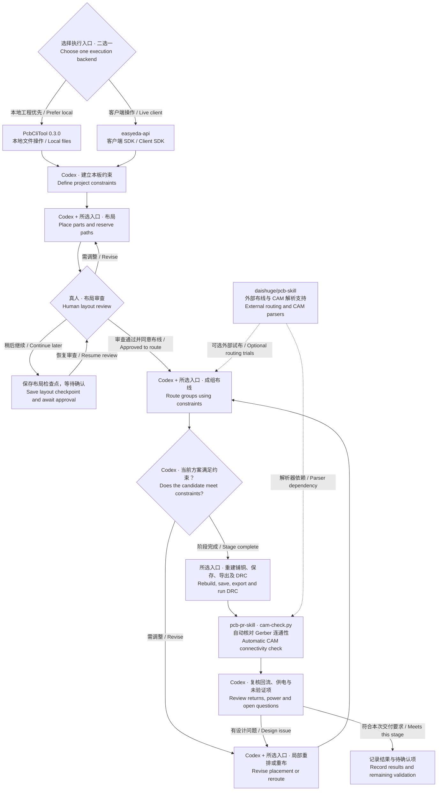

# pcb-pr-skill

用于 Codex 和嘉立创EDA 的 PCB 布局、布线和制造文件核验技能。面向需要把芯片原理图做成可调试测试板的设计者，以及需要比较布线方案、审查回流和交付 Gerber 的 PCB 工程师。

A Codex skill for PCB placement, routing and manufacturing-data verification in EasyEDA. It helps chip designers bring up mixed-signal test boards and PCB engineers compare routing candidates and check the copper submitted for fabrication.

## 工作流程 · Workflow

| 阶段 / Stage | 操作与交付物 / Actions and evidence |
|---|---|
| 冻结基线 / Freeze | 记录工程及板 UUID、网表、固定器件、引脚映射、机械与叠层约束，保存板源。Record the project and board UUIDs, netlist, fixed parts, pin map, mechanical constraints and stackup. Save a source snapshot. |
| 布局 / Place | 先安排接口、光窗、探测空间和供电回流。按引脚顺序成组安排串联器件，放件时检查去耦和测试接法。提交布局供人工审查，通过并确认后进入布线。Reserve mechanical, probing and return-path space. Group series components by pin order and check decoupling and test connections during placement. Submit the layout for human review and obtain approval before routing. |
| 试布与回退 / Route and revise | 在副本按端点组成组扇出，随走线核对参考面、换层、线宽和支路。若串联电阻区形成瓶颈，局部拆线、调整间距、恢复受影响的控制线，再以相同端点比较断点、长度、过孔和回流。On a copy, escape signals in groups and apply reference, transition, width and branch constraints as routing proceeds. At a bottleneck, rip up locally, revise spacing, restore displaced control nets and compare the same endpoints across candidates. |
| 实铜验收 / Verify | 一个布线阶段结束后统一重建铺铜。保存并重开正式板，核对身份、运行原生 DRC，对同版 Gerber、钻孔与带网焊盘表做连通检查。After each routing stage, rebuild pours, save and reopen the target board. Run native DRC and check its Gerbers and drills against an independently derived pad manifest. |

## 在设计过程中应用规则 · Apply rules while designing

布局时先确定网络功能、边沿、电源域、负载和测试接法，再据此选层、安排器件和预留通道。每组开始布线时应用其线宽、间距和参考面要求；经过细颈、换层、端接或调试分支时核对相关条件。阶段结束后再对最终铜形复验。

During placement, identify each group's function, edge rate, power domain, load and test connection, then choose layers and reserve component and routing space. Apply width, clearance and reference-plane requirements when starting each group. Check the relevant conditions as necks, layer transitions, terminations and debug branches are introduced, then recheck the final copper at the stage boundary.

| 类型 / Type | 使用方式 / How to apply |
|---|---|
| 默认建议 / Default guidance | 可覆盖的设计起点。≥10/≥20 mil 线宽及建议孔径和距离只属于项目可选预设。Overridable starting points. Numeric widths, via sizes and distances belong to an optional project preset. |
| 必须检查 / Required checks | 场景存在时核对器件、制造和电气要求，允许有依据的例外。不存在的场景可略过，缺少输入时标明影响并继续独立工作。Check applicable device, fabrication and electrical requirements. Document justified exceptions, skip absent scenarios, and continue independent work when inputs are missing. |

规则并入现有布局与布线参考，覆盖供电瓶颈、去耦、连续回流、差分主支路、上断电状态及可探测性。SPI 详细时序和仪器带宽预算由对应接口与测试方案提供。规则指导 Codex 的设计判断，当前脚本仍负责现场作业与 CAM 连通检查。

The existing placement and routing reference now covers power bottlenecks, decoupling, continuous returns, differential main paths and stubs, power states and probe access. Interface and test plans supply detailed SPI timing and instrument bandwidth budgets. These instructions guide Codex's design decisions. The scripts continue to handle board jobs and CAM connectivity checks.

连续布线期间记录待复验项，阶段结束统一重建铺铜；当前判断依赖实际铜面时提前重建相关区域。查阅[设计规则与可选预设](references/placement-routing.md#设计时使用规则)。

Track pending rechecks during continuous routing and rebuild pours at the stage boundary. Rebuild the relevant regions earlier when a decision depends on filled copper. See [design rules and optional presets](references/placement-routing.md#设计时使用规则).

### 规则如何进入流程 · Rules in the workflow

图中的 **Codex** 表示依据器件资料、项目约束和当前几何作工程判断；**工具**表示调用 EDA/CLI 执行动作；**自动检查**仅指下面列出的已有检查能力。

**Codex** makes engineering judgments from device data, project constraints and current geometry. **Tools** execute EDA/CLI operations. **Automatic checks** refer only to the existing capabilities listed below.



**PcbCliTool 与 easyeda-api 按当前任务二选一。** 图中的“所选入口”沿用这一选择。PcbCliTool 优先处理本地工程，easyeda-api 用于客户端现场操作；`board-job.mjs` 仅用于 easyeda-api 路径。pcb-skill 提供可选外部试布支持，同时是现有 `cam-check.py` 的解析器依赖。所选工具的具体命令和可用能力按其版本文档确认。

**Choose either PcbCliTool or easyeda-api for the current task.** “Selected backend” follows that choice throughout the diagram. Prefer PcbCliTool for local projects and use easyeda-api for live client operations; `board-job.mjs` applies only to the easyeda-api path. pcb-skill supports optional external routing trials and supplies the parser dependency used by `cam-check.py`. Confirm commands and capabilities in the selected tool's versioned documentation.

**布局完成后交给真人审查。** 提供布局图、关键器件位置、供电与回流通道、测试可达性及待确认项。审查通过且用户同意进入布线后再继续；也可保存检查点，之后恢复。布线中局部调整若影响已确认的布局约束，应重新提交受影响部分审查。

**Hand the completed layout to a human reviewer.** Provide layout views, critical component positions, power and return paths, probe access and open questions. Proceed to routing after review approval and the user's go-ahead, or save a checkpoint and resume later. Local routing changes that affect approved placement constraints require review of the affected area.

布线过程中，Codex 在细颈、换层、终端和调试支路等位置应用对应规则。阶段结束复核最终铜形；当前判断依赖实铜时，提前重建相关区域。

During routing, Codex applies the relevant rules at necks, layer transitions, terminations and debug branches. Final copper is reviewed at the stage boundary. Rebuild affected regions earlier when a decision depends on filled copper.

| 执行者 / Responsibility | 当前范围 / Current scope |
|---|---|
| Codex 工程判断 / Engineering judgment | 网络分类、线宽与层分配、器件位置、回流路径、供电瓶颈、探头负载及例外依据。必要时结合手册、计算、仿真与实测。Classifies nets and assesses widths, layers, placement, returns, power bottlenecks, probe loading and exceptions using documentation, calculations, simulation or measurements as needed. |
| PcbCliTool 或 easyeda-api / Selected backend | 执行放件、走线、铺铜、导出和对应 DRC；检查范围取决于工具能力及生效规则。`board-job.mjs` 调用 easyeda-api 的现场作业。Executes placement, routing, pours, exports and the corresponding DRC. Coverage depends on tool capabilities and active rules. `board-job.mjs` invokes live easyeda-api jobs. |
| 已有 CAM 脚本 / Existing CAM script | `cam-check.py` 将 Gerber、金属化钻孔与独立焊盘网表对照，在支持格式和所选分辨率内报告开路、异网共铜和缺铜焊盘。Compares Gerbers and plated drills with an independent pad manifest, reporting opens, shared copper between nets and pads without copper within its format and resolution limits. |

新增规则尚未全部实现为自动扫描。DRC 和 CAM 结果用于支持判断；阻抗、载流与温升、信号质量、回流质量及功能仍按相应方法验证。

The added guidance is not fully implemented as automated scans. DRC and CAM results support the review. Impedance, current capacity, temperature rise, signal integrity, return quality and function still need the appropriate analysis or measurement.

**可选线宽预设。** 空间允许的低压测试板可将普通非阻抗信号 **≥10 mil（0.254 mm）**、供电干线 **≥20 mil（0.508 mm）**作为起始下限。电源按电流、铜厚、长度、允许压降和温升加宽或铺铜；电压与瞬态要求同时决定净距、绝缘及器件额定值。受控阻抗、细脚短出线和敏感模拟节点按专门约束确定，并记录偏离预设的依据。

**Optional width preset.** For low-voltage test boards with sufficient space, use **≥10 mil (0.254 mm)** for ordinary non-impedance-controlled signals and **≥20 mil (0.508 mm)** for supply trunks as starting minimums. Widen power paths or use copper pours according to current, copper thickness, length, allowed voltage drop and temperature rise. Voltage and transients also determine clearance, insulation and component ratings. Controlled-impedance routes, short fine-pitch escapes and sensitive analog nodes use their specific constraints with documented departures from the preset.

## 与上游的关系 · Relationship to upstream

| 项目 / Project | 用途与边界 / Scope |
|---|---|
| [PcbCliTool](https://github.com/cc38324/PcbCliTool) | **优先用于本地文件夹工程的离线 PCB 操作。** 本项目验证版本为 [0.3.0](https://github.com/cc38324/PcbCliTool/releases/tag/v0.3.0)（Windows x64，命令名 `easyedatool`）。已运行官方基础 Demo，并只读核对六层测试板的本地 `.eprj3` 工程。**Preferred for offline PCB operations on local folder projects.** Tested here with version **0.3.0** on Windows x64, invoked as `easyedatool`. Validation covered the official basic demo and read-only inspection of the six-layer test board's local `.eprj3` project. |
| [easyeda-api](https://github.com/easyeda/easyeda-api-skill) | 提供 SDK 文档、桌面扩展与本机网关，负责现场读写。Provides the SDK reference, desktop extension and local bridge for live board access. |
| [daishuge/pcb-skill](https://github.com/daishuge/pcb-skill/tree/6e939b64907e3c63236c7522c511af5d7d1afaad) | 参考的上游版本覆盖更广的 PCB 制作流程，包括布局、布线和 Gerber 工具。本技能的 CAM 检查调用该仓库的解析代码。The upstream workflow covers a broader board-development cycle, including placement, routing and Gerber tools. Our CAM checker imports its parser from a local checkout. |
| **pcb-pr-skill** | 针对 spadfe 中单靠路由完成提示无法判定的三件事补充操作和脚本：拥塞时怎样回退布局、超时后如何确认操作落在哪张板、导出铜层是否连接了所有预期焊盘。Adds procedures for three decisions encountered on spadfe: when to revise placement, how to identify the board and job after a timeout, and how to check exported copper against every expected pad. |

本地工程操作优先考虑 PcbCliTool；需要读取客户端当前状态、通过 SDK 修改图纸或运行本仓库的现场作业脚本时使用 easyeda-api。首次处理已有工程，先核对读取结果，再在副本验证写回。0.3.0 对部分实例引脚编号和跨页连接的解析曾出现差异，需要与原始数据交叉核对；六层测试板尚未通过 PcbCliTool 完成整板重布验证。

Prefer PcbCliTool for local project operations. Use easyeda-api for current client state, SDK edits and the live-job scripts in this repository. For an existing project, verify parsing first, then test writes on a copy. Version 0.3.0 produced some discrepancies when interpreting instance pin numbers and off-page connections, requiring cross-checks against source data. Full-board rerouting of the six-layer example with PcbCliTool remains unverified.

布局和布线采用 Codex、EDA 工具及可选外部路由器协同完成。仓库内脚本负责现场作业和制造文件核验。Placement and routing use Codex, EDA tools and an optional external router. The bundled scripts handle board jobs and CAM checks.

## 安装与复现 · Installation and reproduction

1. 将本仓库放入 Codex 技能目录下的 `pcb-pr-skill/`，确保 `SKILL.md` 位于该目录根部。Install this repository as `~/.codex/skills/pcb-pr-skill/`, with `SKILL.md` at its root.
2. 本地离线操作优先按 [PcbCliTool 安装说明](https://github.com/cc38324/PcbCliTool/blob/main/README.md)准备工具，读取随安装包提供的 `SKILL.md`，并用 `easyedatool --version` 记录版本。For local offline work, set up PcbCliTool, read its bundled `SKILL.md` and record `easyedatool --version`.
3. 使用客户端现场作业时安装 easyeda-api，按其说明加载 `run-api-gateway` 并连接桌面客户端，使用 Node.js 18+。已验证组合为 easyeda-api 1.1.36 与嘉立创EDA 4.1.99。For live jobs, connect the desktop extension to its bridge and use Node.js 18+. The recorded configuration used easyeda-api 1.1.36 with EasyEDA 4.1.99.
4. 离线 CAM 复现需 Python、NumPy、SciPy 及上表所链接提交的 pcb-skill 本地副本。外部自动布线可选 FreeRouting；运行下列检查无需启动路由器。Offline CAM checks require Python, NumPy, SciPy and a local checkout of the linked pcb-skill revision. FreeRouting is optional for external routing trials.

### 从空目录运行双层样板 · Run the two-layer example from scratch

在空的测试项目中打开 PowerShell，准备 Git 和带 `venv` 的 Python。以下命令将技能安装在项目的 `.agents/skills/`，上游仓库和虚拟环境放在其外。打开该项目的新 Codex 会话即可按名称引用 `$pcb-pr-skill`。Open PowerShell in an empty test project with Git and Python available. The commands install a project-local skill and keep the upstream checkout and Python environment outside the skill. Start a new Codex session in that project to invoke it by name.

```powershell
New-Item -ItemType Directory -Force .agents/skills | Out-Null
git clone https://github.com/sanityARO/pcb-pr-skill.git .agents/skills/pcb-pr-skill
git clone https://github.com/daishuge/pcb-skill.git pcb-skill
git -C pcb-skill checkout --detach 6e939b64907e3c63236c7522c511af5d7d1afaad
python -m venv .venv
.\.venv\Scripts\python.exe -m pip install numpy scipy
.\.venv\Scripts\python.exe .agents/skills/pcb-pr-skill/scripts/test-cam.py ./pcb-skill
```

在 macOS/Linux 上，使用 `mkdir -p .agents/skills`、`python3 -m venv .venv` 和 `.venv/bin/python`。CAM 示例只用合成 Gerber 和钻孔文件，运行结束后自动清理。On macOS/Linux, use those directory and interpreter commands with the same Git and script arguments. The example creates temporary synthetic Gerber and drill files and cleans them up on exit.

已在 Windows 独立环境验证 Python 3.10.5、NumPy 2.2.6、SciPy 1.15.3。预期输出顺序为正常、缺少镀孔、两网短接。后两个 `False` 表示成功检出注入的故障。三个用例均符合预期时，测试脚本退出码为 0。Verified in a fresh Windows environment with Python 3.10.5, NumPy 2.2.6 and SciPy 1.15.3. Expected cases are a good board, an open caused by an omitted plated hole, and a short between two nets. Both `False` lines are expected detections. The test process exits with code 0 when all three cases match expectations.

```text
2 nets, 4 pads, passed=True
2 nets, 4 pads, passed=False
2 nets, 4 pads, passed=False
```

### 使用自己的板图 · Check your own board

从技能目录运行下列命令，使用已安装上述依赖的 Python。替换工程及板 UUID、上游路径与文件名。快照需要已连接的 EDA 客户端；独立 CAM 检查需要自己的 Gerber ZIP 和焊盘清单，格式见操作参考。From the skill directory, use the environment above and substitute your UUIDs, paths and filenames. A snapshot requires a live bridge. For standalone CAM verification, supply your own Gerber ZIP and pad manifest. [清单格式与现场操作 / Manifest format and live jobs](references/easyeda-cam.md)

```text
node scripts/board-job.mjs snapshot PROJECT_UUID BOARD_UUID before.epcb
python scripts/cam-check.py check.zip manifest.json report.json --pcb-skill PATH_TO_PCB_SKILL --resolution 0.025
```

真实板需提供同一修订、同一坐标原点的铜层、金属化钻孔和网表焊盘清单。脚本支持正片铜层及圆形贯通镀孔。栅格步长应小于需要辨别的铜颈和间隙，临界位置需更细网格或矢量 CAM 复核。For a real board, supply copper, plated drills and a pad manifest with a common revision and origin. The checker supports positive copper and circular plated through-holes. Resolve narrow features with a finer grid or vector CAM.

## spadfe 测试板 · Worked example

六层 ToF/DVS 测试板包含倒装 QFP144、光学开窗、FPGA 接口、160 MHz 时钟、灯板 LVDS 和阵列供电。冻结版记录 52 处断点。保留固定接口并重排 FPGA 电阻组与 DUT 两侧扇出后，试布收敛到 4 处，随后补齐。正式板原生 DRC 报告 0 项；按 0.025 mm 网格核对导出铜，303 个预期网络的 1,134 个焊盘通过连通检查。灯板 LVDS 主路径和调试支路需分别检查参考面，主路径的覆盖结果不能外推到支路。这些是已记录的 CAD/CAM 结果，样板验证仍待完成，阻抗、瞬态压降和成像性能需另行验证。

The six-layer spadfe ToF/DVS test board combines an inverted QFP144, an optical aperture, FPGA headers, a 160 MHz clock, LVDS lighting control and an array supply. The frozen design had 52 routing gaps. Regrouping the FPGA resistors and DUT escapes around fixed interfaces reduced the trial to four gaps, which were then closed. Native DRC reported zero items on the formal board. Exported copper passed the connectivity check for 303 expected nets and 1,134 pads on a 0.025 mm grid. The LVDS main path and debug stub were evaluated separately. These results document CAD and CAM checks. Impedance, transient droop and imaging performance require separate measurement.

公开示例提供方法与结果摘要；上述命令可在合成样板或读者自己的板上运行。The public example documents the method and recorded results. Reproduce the checker on its synthetic fixture or apply it to your own board.

## 操作参考 · Operator references

- [技能入口 / Codex instructions](SKILL.md)
- [布局、布线与回退 / Placement, routing and rollback](references/placement-routing.md)
- [板图作业、输入格式及 CAM 限制 / Board jobs, manifest and CAM limitations](references/easyeda-cam.md)
